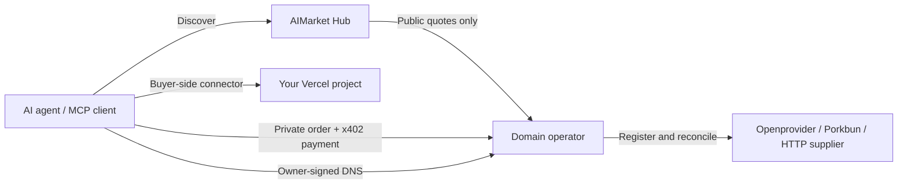

<!-- aicom-mirror-notice -->
> **🔄 Synced from a monorepo — but with a live history.** `domain-kit` mirrors the
> canonical AI-Factory monorepo. History here is append-only (no force-push).
> **Pull requests are welcome** — merged PRs are imported back into the monorepo
> and re-synced here, so your contribution becomes canonical.
> 💬 **[Issues](https://github.com/alexar76/domain-operator-kit/issues)** · **[Pull requests](https://github.com/alexar76/domain-operator-kit/pulls)** both welcome.

<p align="center">
  
</p>

<h1 align="center">Domain Operator Kit</h1>
<p align="center"><strong>Sell domains to AI agents. Bring your supplier. Keep control of your business.</strong></p>

<p align="center">
  <a href="LICENSE"></a>
  <a href="package.json"></a>
  <a href="examples/mcp.json"></a>
  <a href="PROTOCOL.md"></a>
  <a href="VALIDATION.md"></a>
  <a href="PILOT.md"></a>
</p>

<p align="center">
  <a href="#try-it-locally">Quickstart</a> · <a href="PROTOCOL.md">Capabilities</a> · <a href="SUPPLIERS.md">Bring a supplier</a> · <a href="PILOT.md">Pilot plan</a> · <a href="OPERATIONS.md">Operator guide (RU)</a>
</p>
<p align="center"><strong>English</strong> · <a href="README.ru.md">Русский</a></p>

An agent can build and deploy an application. This kit lets it take the next step: obtain a signed price for a domain, register it to its real owner, manage DNS and connect it to a Vercel project.

Independent operators run their own seller nodes, use their own registrar accounts and set a **fixed markup per registration or renewal**. Agents use a shared capability contract and a budgeted MCP client.

> **Pre-live release.** The local tests and Openprovider and Porkbun Sandbox pilots pass: registration, DNS, renewal, lost-response recovery and MCP reads. Production domain purchases, payment settlement and Vercel attachment remain unverified. The default demo buys nothing. [Verification record →](VALIDATION.md)

## What the buyer gets

**One exact domain, registered for one year to the supplied registrant.** The quote shows the supplier cost, fixed markup and final amount before payment. For example, a $10 supplier cost plus a $2 markup gives a 12 USDC order; these are illustrative amounts, not a registrar tariff.

DNS management and domain information are included. Renewal is a separate purchase at a newly quoted price. Registrar autorenew is disabled. Availability is not a reservation, and registrant email verification may still require action by the owner.

The built-in registrar scope is `.com`, `.net` and `.org`, ordinary ASCII names, one year. Premium names, IDNs, incoming transfers and expired-domain restoration are outside this release.

## One product, three roles

| You are | What you use |
|---|---|
| **A domain operator or reseller** | Your registrar account, receiving wallet, refund reserve and fixed markup; a seller node with durable orders |
| **An independent supplier** | The [HTTP supplier contract](SUPPLIERS.md), implemented in your own language and infrastructure |
| **An agent or app developer** | Signed `domains.*@v1` capabilities, the JavaScript client or the [stdio MCP configuration](examples/mcp.json) |



The Hub handles discovery. Orders, registrant contacts, payment authorizations and DNS operations go directly to the seller. This implementation charges no Hub commission. The Vercel token stays with the buyer.

## Try it locally

Use Node.js **22.13+**; local verification used **22.22.1**. From `domain-kit/` in the monorepo, or from the root of a satellite checkout:

```sh
npm ci --ignore-scripts
npm run check
npm test
npm run demo
```

The demo runs a signed HTTP lifecycle: **quote → simulated registration → DNS → renewal**. No registrar account, wallet funding or external service is needed. Local HTTP tests require permission to listen on localhost.

For the simplest external API test, use the [Porkbun Sandbox quickstart](PORKBUN.md): automatic disposable credentials, virtual credit and a resumable end-to-end pilot. The Porkbun adapter is sandbox-only until a production pilot passes.

For the Openprovider Sandbox API integration test, follow the opt-in [`npm run sandbox:pilot` instructions](PILOT.md#повторяемый-sandbox-пилот). The script retains its state and reuses the same orders on repeat runs.

For a persistent demo server:

```sh
cp .env.example .env
node --env-file=.env src/server.js
```

In another terminal:

```sh
DOMAIN_ALLOW_DEMO=1 node bin/domain-rails.mjs check http://127.0.0.1:9495
```

This checks the public quote protocol and signature; it does not certify the seller. The server persists encrypted documents and keys in `data/`. Do not discard that directory between deployments.

## Agent capabilities

| Capability | Purpose |
|---|---|
| `domains.quote@v1` | Availability, exact registration price or private renewal quote |
| `domains.register@v1` | Register the quoted name for one year |
| `domains.renew@v1` | Renew an owned domain using a new quote |
| `domains.order.status@v1` | Recover a pending order and retrieve its signed receipt |
| `domains.info@v1` | Expiry, nameservers and required owner actions |
| `domains.dns.get@v1` | DNS records and revision |
| `domains.dns.set@v1` | Replace selected record sets while preserving other names and types |
| `domains.transfer.code@v1` | Private transfer code, where supported; excluded from the MCP tool list |

[Machine-readable contract](spec/domains-v1.json) · [Authentication and payment protocol](PROTOCOL.md)

### Connect a buyer

```sh
node bin/domain-rails.mjs init-owner /private/path/owner.pem
```

Adapt [examples/mcp.json](examples/mcp.json) for a client that supports stdio MCP. Pin the seller's public key through a trusted catalog, configure the owner's signing key and contact file, then set a per-purchase and daily budget. Purchases default to disabled.

`DOMAIN_REGISTRANT_FILE` injects the contact locally. Wallet and owner keys come from private files, never model arguments. Payment authorizations and budget reservations are persisted before sending. A retry reuses its original authorization; an unknown outcome keeps its budget reserved.

Keep the original `client_order_id` and order body across retries. A pending response is a reason to check status, not to create a second purchase. The user or client policy must authorize purchases and acceptance of seller terms.

### Connect the domain to Vercel

Configure `VERCEL_TOKEN_FILE`, `VERCEL_PROJECT_ID` and optionally `VERCEL_TEAM_ID` in the buyer's environment. The MCP client exposes `vercelConnect`:

```json
{"domain":"your-owned-domain.com"}
```

The connector uses Vercel's current DNS recommendations, adds the apex domain to the pinned project and preserves existing TXT verification values and unrelated records. Replacing other A records requires explicit `replace_existing:true`. Conflicting AAAA/CNAME records must first be removed through the DNS provider's console.

`waiting_for_verification_or_dns` means propagation or verification is still pending. `configured` reflects the Vercel API, not an independent HTTPS reachability test. The seller itself requires a persistent Node process and disk; it is not a Vercel Function.

## Bring your supplier

**Openprovider** and **Porkbun Sandbox** have built-in adapters. Other suppliers implement the common HTTP endpoints for quotes, contact preparation, submission, reconciliation and management. Operators retain their own accounts, pricing and payment destination.

[Supplier contract and runnable simulator →](SUPPLIERS.md)

Supporting the contract makes integration possible; it does not make an untested supplier production-ready. Our [pilot plan](PILOT.md) starts with Openprovider Sandbox and our own agent, then a controlled domain for our own Vercel project, before involving outside customers.

## Built for interrupted operations

- **Durable order identity.** Changed input cannot silently reuse an existing order. A wallet signature binds payment to the order and owner key.
- **No blind mutation retries.** Lost payment and registrar responses enter reconciliation using the original evidence.
- **Refunds for proven non-delivery.** Refunds target the original payer. Ambiguous outcomes remain pending; refunds require a funded reserve and functioning infrastructure.
- **Private management.** Owner requests and seller responses use Ed25519; document bodies use AES-256-GCM. Database row identifiers, including domain names, are not encrypted.
- **Explicit operational limits.** One seller process per SQLite database. Openprovider renewal ambiguity may require documented operator evidence. Porkbun replays use a durable idempotency key only within a 23-hour window; older unknown outcomes require review. DNS revision checking is not an atomic lock against outside console edits.

No automatic expiry notifications, renewal scheduler, owner-key recovery or general DNS deletion API is included. Operators must provide those support procedures before serving customers. See [OPERATIONS.md](OPERATIONS.md).

## Repository status

Canonical source is `domain-kit/` in the AIMarket monorepo. The GitHub satellite is [alexar76/domain-operator-kit](https://github.com/alexar76/domain-operator-kit). From the monorepo root the same commands are `npm test --prefix domain-kit` (and `npm run check --prefix domain-kit`). A Node 22/24 CI workflow, Docker/Compose definitions and local branding assets are included. The workflow is prepared; this README does not claim it has run on GitHub. The local test badge links to a dated verification record.

This package remains `private:true` to prevent accidental npm publication. No hosted demo or published package is implied by the quickstart.

MIT licensed. Base payment reconciliation was adapted from the AIMarket eSIM operator kit; see [NOTICE.md](NOTICE.md).
