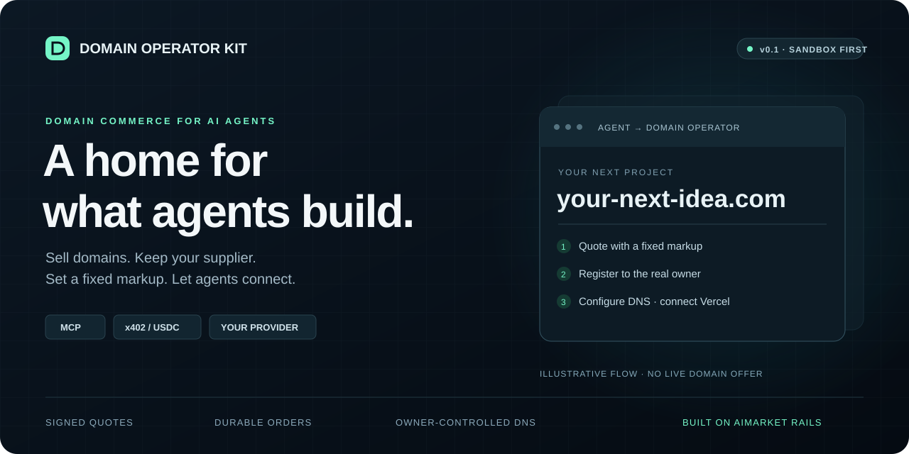
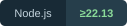
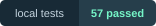

<p align="center">
  
</p>

<h1 align="center">Domain Operator Kit</h1>
<p align="center"><strong>Продавайте домены агентам. Подключайте своего поставщика. Задавайте фиксированную наценку.</strong></p>
<p align="center">
  <a href="LICENSE"></a>
  <a href="package.json"></a>
  <a href="examples/mcp.json"></a>
  <a href="PROTOCOL.md"></a>
  <a href="VALIDATION.md"></a>
  <a href="PILOT.md"></a>
</p>
<p align="center"><a href="README.md">English</a> · <strong>Русский</strong> · <a href="PILOT.md">План пилота</a> · <a href="SUPPLIERS.md">Подключение поставщика</a></p>

Домены как цифровой товар для агентов: **регистрация на год → DNS → подключение к Vercel → отдельное продление**. Независимый оператор задаёт фиксированную наценку и подключает своего поставщика. Агент получает цену до оплаты и подписанную квитанцию после подтверждения регистрации.

Это реализация сервиса, HTTP capabilities и MCP-клиента. По умолчанию включена симуляция. Реальная регистрация и расчёты требуют настройки оператора и проверки с его аккаунтами; эта версия не проходила покупку в production. Sandbox-пилоты Openprovider и Porkbun пройдены: регистрация, DNS, продление, восстановление потерянного ответа и MCP-чтение. [Повторить пилот](PILOT.md#повторяемый-sandbox-пилот).

## Что продаём

**Один конкретный домен, зарегистрированный на переданного владельца на один год.** Цена = закупочная стоимость в USD + фиксированная наценка оператора. Оплата — USDC в Base через x402 v2. Например, при закупке $10 и наценке $2 агент платит 12 USDC. Это пример расчёта, не текущий тариф регистратора. Комиссия Hub в реализации — 0.

DNS и сведения о домене входят в управление. Продление — самостоятельный заказ с новой ценой. Автопродление регистратора выключено; прежняя цена продления не обещается. Оператор отвечает за своевременное уведомление владельца об истечении срока и поддержку.

На старте: `.com`, `.net`, `.org`, обычные ASCII-имена, один год. Premium, IDN, восстановление истёкших доменов и входящие трансферы не включены. Наличие домена в котировке не резервирует его. Иногда владелец должен подтвердить email — статус возвращает `action_required`.

## Проверить за минуту

Нужен Node.js 22.13+ с `node:sqlite` (рекомендуется 22.22.1+).

```sh
# Из domain-kit/ в монорепозитории или из корня спутника domain-operator-kit:
npm ci --ignore-scripts
npm run check
npm test
npm run demo
```

`demo` выполняет настоящий локальный HTTP-цикл с проверкой подписей: котировка, покупка, DNS, продление. Регистратор и платежи имитируются, денег не нужно. HTTP/MCP-тестам требуется возможность слушать localhost.

Для самого простого внешнего API-пилота — [Porkbun Sandbox](PORKBUN.md): автоматическая выдача тестовых ключей и виртуальный баланс. Адаптер Porkbun пока разрешает только sandbox.

Постоянный локальный сервер:

```sh
cp .env.example .env
node --env-file=.env src/server.js
```

В другом терминале:

```sh
DOMAIN_ALLOW_DEMO=1 node bin/domain-rails.mjs check http://127.0.0.1:9495
```

База заказов и ключи создаются в `data/`. `check` проверяет формат и подпись публичной котировки; он не подтверждает регистрацию, репутацию оператора или владение доменом.

### Публичный узел: демо, пока не введены ключи

`DOMAIN_MODE=auto` — для узла, который вы публикуете до начала продаж. Без ключей это **публичное демо**: доступность настоящая (RDAP самих реестров для `.com`, `.net`, `.org`), котировки подписаны и помечены `demo` с иллюстративными ценами, чтение работает, и только `register` и `renew` отвечают `403 demo_mode`. Когда введены все настройки live (production-ключи регистратора или HTTP-поставщик, `PAY_TO`, `CDP_KEY_FILE`, `DOMAIN_REFUND_KEY_FILE`, HTTPS `DOMAIN_PUBLIC_URL` и `DOMAIN_TERMS_URL`, `DOMAIN_UPSTREAM_COST_CONFIRMED=1`), следующий запуск продаёт по-настоящему. До этого `/healthz` перечисляет имена недостающих настроек (`live_missing`), но не их значения. Porkbun остаётся только sandbox. Такой узел работает на modelmarket.dev как витрина доменов.

## Capabilities

| Capability | Результат | Доступ |
|---|---|---|
| `domains.quote@v1` | Наличие, цена, наценка, срок котировки, оценка продления | Публично для регистрации; владелец для продления |
| `domains.register@v1` | Заказ на регистрацию на год | Подпись владельца + платёж |
| `domains.renew@v1` | Заказ на продление на год | Подпись владельца + платёж |
| `domains.order.status@v1` | Состояние заказа, квитанция или возврат | Владелец |
| `domains.info@v1` | Срок, nameservers, требуемые действия | Владелец |
| `domains.dns.get@v1` | Записи и текущая ревизия зоны | Владелец |
| `domains.dns.set@v1` | Замена указанных наборов DNS-записей | Владелец |
| `domains.transfer.code@v1` | Секретный код переноса, если поддержан | Владелец; исключён из MCP |

Машинный контракт: [spec/domains-v1.json](spec/domains-v1.json). Протокол подписи, оплаты и ошибок: [PROTOCOL.md](PROTOCOL.md).

## Агент-покупатель

```sh
node bin/domain-rails.mjs init-owner /private/path/owner.pem
```

Используйте [пример конфигурации MCP](examples/mcp.json) для клиента, поддерживающего stdio MCP. Укажите абсолютные пути, доверенный ключ продавца, реальные данные владельца в отдельном файле и выделенный кошелёк с лимитом. Публичный ключ продавца закрепляется из доверенного каталога: скачанный `listing.json` сам по себе доверие не создаёт.

Покупки по умолчанию выключены. `DOMAIN_BUY_MAX_USD` ограничивает одну покупку, `DOMAIN_BUY_DAILY_USD` — сумму авторизаций за сутки UTC. Платёжная авторизация и дневной бюджет сохраняются до отправки запроса. При неопределённом исходе бюджет остаётся занят, а повтор использует исходную авторизацию. Не удаляйте клиентскую базу для обхода лимитов.

`DOMAIN_REGISTRANT_FILE` подставляет контакт локально: модель не передаёт адрес и телефон в аргументах инструмента. Это не скрывает контакт от оператора и регистратора, которым он нужен для регистрации. Ключи кошелька и владельца всегда читаются из файлов, не из аргументов модели.

Последовательность агента:

1. `quote` для точного имени. Оценить цену и условия продавца.
2. `register` с `quote_id`, устойчивым `client_order_id` (16–80 символов), `accept_terms: true`, `terms_version`. Сохранить вход и `order_id`.
3. При `202` проверять `status`. При потере ответа повторить тот же запрос с тем же ID. Новый ID означает новую покупку.
4. После `delivered` прочитать `info` и выполнить требуемое подтверждение email.
5. Прочитать DNS и изменить необходимые наборы записей с полученной `revision`.

Принятие условий и разрешение на расходы должен определять пользователь/политика клиента. Наличие MCP-инструмента само по себе не выдаёт агенту полномочий покупать любые имена.

## Фабрика → Vercel

Добавьте в окружение MCP-процесса `VERCEL_TOKEN_FILE`, `VERCEL_PROJECT_ID` и при необходимости `VERCEL_TEAM_ID`. Появится инструмент `vercelConnect`:

```json
{"domain":"your-owned-domain.com"}
```

Он проверяет владение доменом, подключает apex-домен к заданному проекту и берёт A-записи из текущей рекомендации Vercel. TXT-подтверждение добавляется с сохранением существующих TXT; остальные MX/TXT не затрагиваются. Токен Vercel остаётся на стороне покупателя. Проект закреплён в настройке, менять его ответом поставщика нельзя.

Другая существующая A-запись требует `replace_existing: true`. Конфликтующие AAAA/CNAME нужно сначала убрать через кабинет DNS-провайдера: удаление наборов DNS в v1 не реализовано. Статус `waiting_for_verification_or_dns` означает, что нужно повторить проверку после распространения DNS. `configured` отражает API Vercel, а не проведённую проверку HTTPS-доступности сайта.

Если ваша фабрика уже деплоит на Vercel, этот клиент добавляет следующий шаг. Подключение домена выполняется отдельно от деплоя. Сам оператор доменов работает как постоянный Node-процесс с диском, а не как Vercel Function.

## Независимые продавцы

Два варианта подключения:

* Поднять собственный экземпляр kit с собственными ключами, наценкой, оплатой и аккаунтом регистратора. Есть адаптеры Openprovider и Porkbun Sandbox.
* Подключить любой другой backend через [HTTP supplier contract](SUPPLIERS.md). Язык и инфраструктура произвольны; поставщик реализует регистрацию, сверку и управление с описанными гарантиями.

В Hub отправляется только публичная capability котировки. Покупка, контакт владельца, платёжные авторизации и DNS-запросы идут напрямую продавцу. [Инструкция федерации и запуска](OPERATIONS.md) содержит генерацию `node.toml`, sandbox, Docker и порядок восстановления.

Открытость протокола не означает, что любой непроверенный API автоматически становится надёжным продавцом. Подключение нового поставщика требует реализации контракта и проверки его фактической выдачи.

## Гарантии и границы

* Цена считается целыми микродолларами; скрытого изменения суммы после оплаты нет.
* Заказ, владелец, контакт и версия условий связаны устойчивым ID и хешем. Кошелёк дополнительно подписывает привязку платежа к заказу и ключу владельца.
* После сбоя сверка использует исходную платёжную авторизацию и сведения регистратора. Porkbun допускает повтор строго с сохранённым ключом идемпотентности в пределах 23 часов; новый заказ автоматически не создаётся.
* Однозначно подтверждённая невыдача переводит заказ к возврату исходному плательщику. Неопределённый исход остаётся pending. Возврат зависит от доступности и баланса резервного кошелька, лимитов и инфраструктуры.
* Документы SQLite зашифрованы AES-256-GCM, запросы владельца и ответы продавца подписаны Ed25519. Идентификаторы строк, включая доменные имена, не скрыты шифрованием документов.
* Один процесс продавца на одну SQLite-базу. Для большого потока нужна серверная БД и очередь; это не реализованная горизонтальная масштабируемость.
* Для Openprovider потерянный ответ на продление может потребовать ручного подтверждения оператора: одного увеличения срока недостаточно, чтобы доказать выполнение именно этого заказа.
* DNS revision предотвращает устаревшие изменения внутри сервиса. Openprovider не предоставляет здесь атомарный compare-and-swap, поэтому параллельные правки через его кабинет нужно исключить.

Детали ограничений и эксплуатации — в [OPERATIONS.md](OPERATIONS.md). Результаты локальной проверки — в [VALIDATION.md](VALIDATION.md).
